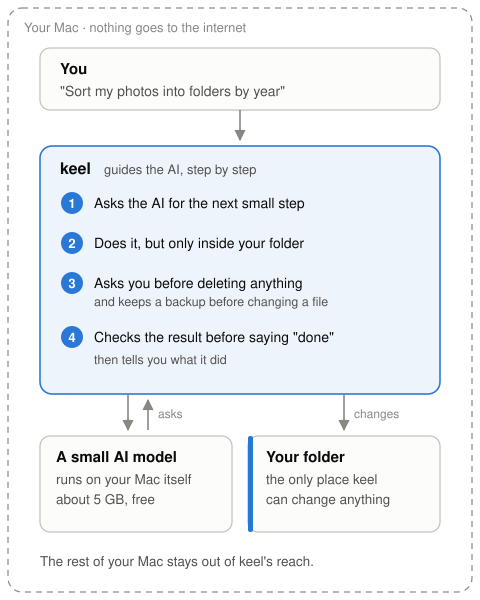
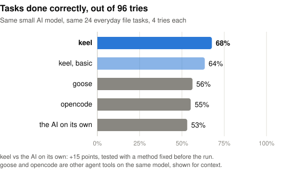

<p align="center">
  
</p>

**keel lets a small AI that runs on your own Mac do real jobs in your folders, and it asks before it deletes
anything.**

You tell it what you want in plain words ("sort these photos into folders by year"), and it does the work step by step:
it looks at the files, moves and renames them, and tells you what it did. The AI runs on your Mac itself, so your files
never leave it, and there is no account and no monthly fee.


*A real run, sped up 6×: keel sorts a messy Downloads folder, finds two duplicates, asks before deleting them (the
first answer is "no", so nothing is deleted), and deletes them only after a "yes". We recorded it four times: two runs
were perfect (this is one), and in the other two keel misplaced a file or kept the copies instead of the originals.
That's in line with the results below.*

---

## What you can ask it

Everyday file chores in one folder, for example:

- "Sort these photos into folders by year"
- "Find the duplicate files and remove the extra copies"
- "Rename the invoices to `2025-03 Acme.pdf` style"
- "Fix the dates in this spreadsheet so they are all the same format"
- "Make a list of every PDF here with its size"
- "Which of these notes mention the dentist?"

It works best on clear, single-folder jobs like these. It is not a chat assistant for general questions, and it does
not browse the internet.

## Why it is different

- **Private.** The AI runs on your Mac. After the one-time download, keel works with no internet at all: nothing you
  do is sent anywhere.
- **Careful.** keel can only change the folder you give it. It **always asks before deleting a file**, and this can't
  be switched off. Before it changes or deletes anything it quietly keeps a backup you can bring back.
- **Honest.** We measured how often it gets jobs right, with the test decided before the results were in, and we show
  where it still fails (below).

## How it works

<p align="center">
  
</p>

Small AI models are cheap, private and fast enough to run on a laptop, but on their own they are unreliable: they lose
track of long jobs, repeat themselves, or say "done" too early. keel is the steady part around the AI. It gives the AI
simple, safe tools, keeps it on track one step at a time, and checks the work before it reports back. (A keel is the fin
under a boat that keeps it steady. That's the idea.)

## Does it work?

<p align="center">
  
</p>

We gave the same small AI 24 everyday file tasks, 4 times each (96 tries). With keel it finished **68%** correctly;
on its own, **53%**. That difference is real, not luck: we wrote down how we would test it before running anything,
and it passed (the chance of a gain this big by luck is about 1 in 80). Two other popular agent tools, run on the same
AI, scored 56% and 55%.

**What it still gets wrong.** About 1 in 3 jobs is not done right. Most often it makes a judgment mistake on the data
(a photo filed under the wrong name, a file it missed) and then says it is done. So for anything important, check the
result. This is a small AI on a laptop, not a large cloud AI, and it's honest to say so.

## What you need

- A Mac with Apple Silicon (M1 or newer). Tested on a 16 GB M4 Mac with macOS 26; 16 GB of memory is recommended.
- About 6 GB of free disk space (most of it is the AI model).
- The **Terminal** app (it comes with every Mac: press ⌘ Space and type "Terminal").

## Install

> keel isn't published yet: the first public release (v0.1) is being prepared. These are the steps it will use.

1. Install **uv**, a small tool that installs keel. In Terminal, paste:
   ```
   curl -LsSf https://astral.sh/uv/install.sh | sh
   ```
2. Install keel:
   ```
   uv tool install keel
   ```
3. Get the AI model (about 5 GB, one time). keel shows the size and asks before downloading:
   ```
   keel download
   ```
4. Check that everything is ready:
   ```
   keel doctor
   ```

## Use it

Point keel at a folder and type what you want done:

```
keel run --dir ~/Desktop/photos
```

keel opens, shows its little robot, and waits for you to type a task. Then it works step by step and shows each thing
it does. You can type a follow-up when it finishes, or press **Esc** to leave.

**When it wants to delete something**, keel stops and lists the files:

```
⚠ Delete 2 files?
    IMG_2041 (1).jpg
    invoice_march copy.pdf
  y  delete    n  keep
```

Press **y** to delete or **n** to keep them. Pressing Enter does nothing, so you can't say yes by accident.

**To undo a change**, keel keeps a copy of every file before it changes or deletes it:

```
keel backups                      list your sessions with backups
keel backups <session>            what was backed up in that session
keel backups <session> --restore 3   put file number 3 back
```

## Uninstall

```
uv tool uninstall keel
```

That removes the program. Your folders are never touched. keel's own files stay until you delete them yourself:
your session history and backups in `~/Library/Application Support/keel`, and the AI model (about 5 GB) in
`~/.cache/huggingface/hub` (the folder whose name contains `Qwen3.5-4B-8bit`).

## What keel protects, and what it doesn't

| keel does | keel does not |
|---|---|
| Work only inside the folder you give it; the rest of your Mac is out of its reach | Stop a wrong change *inside* that folder (that's what the backups are for) |
| Ask before every delete, with no way to turn that off | Work on very big folders: over 5,000 files or 500 MB it refuses, to keep backups quick |
| Keep a backup before it changes or deletes a file (the newest 50 sessions are kept) | Run on Windows or Linux (its safety rules use a feature only Macs have) |
| Run with no internet: it can't upload, download or send email | Know things a small AI doesn't: it can misread a file or make a wrong call |

## Questions

**Is it free?** Yes. keel is open source (MIT licence) and the AI model is free to download.

**Does it send my files anywhere?** No. After the model download, keel needs no internet, and its rules block network
access for everything it runs.

**How long does a job take?** Usually a minute or two for a folder of a few dozen files. The AI thinks at a few words a
second on a laptop.

**Which AI does it use?** Qwen3.5-4B, a small open model from the Qwen team, in a version made for Apple Silicon. It's
about 5 GB.

**Can I use a bigger model?** Yes, if you run one in Ollama, LM Studio or a similar app: see `keel run --help` for the
`--backend` option. The measured results above are for the default small model running inside keel.

**Something went wrong. What now?** Run `keel doctor`: it checks your Mac and says what to fix. keel's error messages
for the usual first-run problems (no model yet, a folder that is too big) say what to do next.

---

## For developers

keel is a Python core (the agent loop, tools, sandbox and evals, in `src/keel/`) with a Rust terminal app on top
(`crates/`). The two talk over the Agent Client Protocol, so editors that speak ACP can drive keel too.

```
uv sync && uv run --no-sync keel-core install-bfcl     # set up (bfcl-eval is installed without its pins)
cargo build                                            # the keel terminal app
just test                                              # all checks that need no model
uv run keel-core eval --list                           # eval suites: agent tasks, BFCL multi-turn, When2Call
uv run keel-core compare <runA> <runB>                 # is a change a real gain, or noise?
```

- **The headline result can be re-checked from the files alone:** `uv run python evidence/ch6-headline/verify.py`
  (the pre-registered tests, the runs and the exact code; see `evidence/ch6-headline/README.md`).
- **Tasks:** each of the 24 tasks has a card in `task-cards/` with what is checked and how.
- **Docs:** short pages on how keel is built, safety, how we measure, commands, adding a task or a backend:
  [`docs-keel/`](docs-keel/README.md). What changed: [`CHANGELOG.md`](CHANGELOG.md).
- Licence: MIT (`LICENSE`). Third-party data and tools: `THIRD_PARTY_NOTICES.md`.
