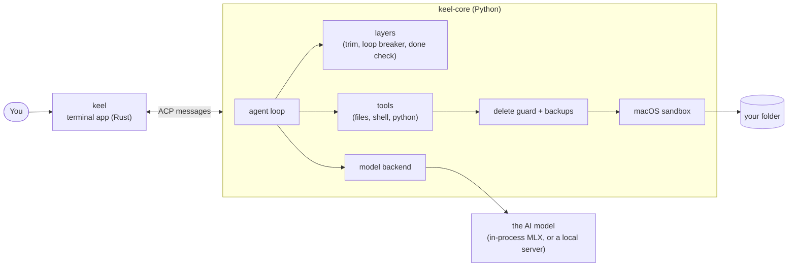

# How keel is built

keel has two programs. **`keel`** (Rust, `crates/`) is the terminal app you see. **`keel-core`** (Python, `src/keel/`)
does all the work: it runs the AI, the tools and every safety check. They talk over the
[Agent Client Protocol](https://agentclientprotocol.com) (JSON messages on stdin/stdout), so the terminal app only shows
what the core sends, and any editor that speaks ACP can drive keel too.

## One task, step by step

1. You type a task. The terminal app sends it to keel-core.
2. The **agent loop** (`agent/loop.py`) asks the model for its next step. The model answers with text and, usually, a
   tool call ("list the files", "move this file").
3. The **tool** runs inside a **sandbox** (`agent/sandbox.py`): it can only write in your folder and has no network.
4. If the step would delete files, the **delete guard** (`agent/guard.py`) tries it on a scratch copy first, lists what
   would go, and asks you. Before any file is changed or deleted, a backup is kept (`agent/backups.py`).
5. The result goes back to the model, shortened if it is huge (`trim.py`). If the model repeats the same call, the
   **loop breaker** steps in (`core/layers.py`).
6. When the model says it is done, a **done check** (`agent/done_gate.py`) looks at what changed (for example, a
   broken CSV) and sends it back, at most twice, if something is wrong. Then you get the answer.

## The parts

| Part | What it does |
|---|---|
| Stacks | Named sets of layers: `bare` (the plain model, one shell tool), `keel` (file tools, loop breaker, trim), `full` (the default: adds the done check, GNU tool shims, worked examples, a Python tool and a search hint; measured best) (`stacks.py`) |
| Backends | `mlx.py` runs the model inside keel (the measured path); `server.py` talks to Ollama, LM Studio, mlx_lm.server (`backends/`) |
| Model store | Finds the model (models folder, then the Hugging Face cache) and downloads it with `keel download` (`modelstore.py`) |
| Paths | The one place that knows where things live; environment variables move them (`paths.py`) |
| Long sessions | Shortens old turns so a long conversation fits the model's memory (`agent/compact.py`) |
| Evals | Runs task suites and compares two runs (see [How we measure](how-we-measure.md)) (`evals/`, `commands/`) |

The model never sees how keel is built: everything it gets is the conversation, the tool list and the tool results.
